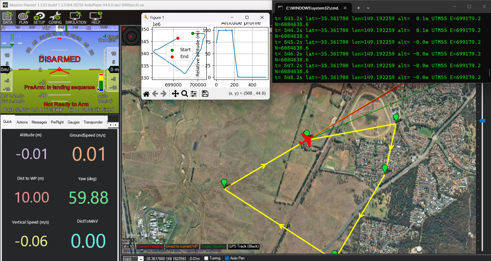
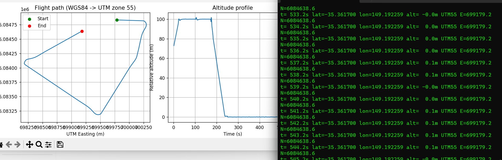

# Drone Flight Tracker

A small Python project that records telemetry from a simulated drone, saves the flight data to a CSV file, and visualizes the flight path and altitude profile.

The project uses **ArduPilot SITL (ArduPlane)**, **MAVLink**, coordinate conversion with **PyProj**, and charts created with **Matplotlib**.

## Demo

### Mission Planner simulation

The aircraft follows a waypoint mission in Mission Planner while the Python script reads telemetry from the simulator.



### Flight path and altitude profile

The first chart shows the aircraft's flight path from above using UTM coordinates in meters. The second chart shows relative altitude over time. The plotted data comes from a waypoint mission flown in the simulator.



## Features

- Connects to a simulated ArduPilot aircraft running in SITL.
- Reads live position and altitude from MAVLink `GLOBAL_POSITION_INT` messages.
- Converts WGS84 latitude/longitude coordinates to UTM coordinates in meters.
- Automatically selects the UTM zone based on the aircraft's position.
- Logs telemetry readings to `flight_log.csv`.
- Plots the flight path and altitude profile.
- Prints basic flight statistics, such as flight duration, maximum altitude, and distance.

## Tech stack

- Python 3.9+
- ArduPilot SITL (ArduPlane)
- Mission Planner
- MAVLink / `pymavlink`
- `pyproj`
- `matplotlib`
- CSV

## Project structure

```text
drone-flight-tracker/
├── telemetry.py                  # Reads telemetry and writes the CSV log
├── plot_flight.py                 # Creates charts and prints flight statistics
├── flight_log.csv                 # Example telemetry log
├── flight_plot.png                 # Generated chart image (optional)
├── images/
│   ├── mission-planner-flight.png  # Mission Planner simulation screenshot
│   └── flight-path-and-altitude.png
└── README.md
```

## Installation

Make sure Python 3.9 or newer is installed. Install the required Python packages:

```bash
pip install pymavlink pyproj matplotlib
```

## How to run

1. Open Mission Planner.
2. Go to the **Simulation** tab and start an ArduPlane vehicle.
3. Confirm the simulator's TCP endpoint. The example configuration in `telemetry.py` uses port `5762`; depending on your setup, port `5763` may be available instead.
4. Start the telemetry logger:

   ```bash
   python telemetry.py
   ```

5. Fly the vehicle in the simulator. For example, load a waypoint mission and switch to **AUTO** mode.
6. Stop logging with `Ctrl+C`. The telemetry data is saved to `flight_log.csv`.
7. Generate the charts:

   ```bash
   python plot_flight.py
   ```

## Output

The project produces:

- `flight_log.csv` — recorded telemetry readings.
- A flight-path chart using UTM Easting and Northing coordinates.
- An altitude profile showing relative altitude over time.
- Basic flight statistics printed in the terminal.

## Troubleshooting

If the script cannot connect to the simulator:

- Check that SITL is running.
- Verify the TCP port configured in `telemetry.py`.
- Try port `5763` if the configured port `5762` does not work in your setup.
- Make sure the connection string used by `pymavlink` matches the simulator endpoint.

## What I learned

- How telemetry moves between a simulated aircraft and a ground station over MAVLink.
- The difference between geographic WGS84 coordinates and metric UTM coordinates, and why UTM is useful for analysing distances and flight paths.
- How to record, process, and visualize flight telemetry with Python.
- How to inspect a waypoint mission using both Mission Planner and custom plots.

## Possible next steps

- Record additional MAVLink messages, such as attitude, battery status, and GPS quality.
- Test the logger with PX4 SITL as well as ArduPilot SITL.
- Run the logger on a companion computer, such as a Raspberry Pi.

## Author

**Huseyin Zakariyayev**  
Software engineer based in Baku, Azerbaijan.

- [LinkedIn](https://www.linkedin.com/in/huseyinzakariyayev/)
- [GitHub](https://github.com/HuseyinZekeriyayev)
